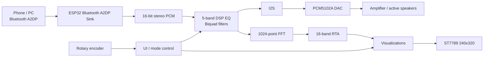

# ESP32 Bluetooth Audio Receiver + RTA + 5-Band EQ

A Bluetooth A2DP audio receiver based on the classic **ESP32-WROOM**, featuring:

- Bluetooth Classic / A2DP audio reception
- real-time 5-band digital equalizer
- I2S output to a **PCM5102A / WCMCU-5102** DAC
- FFT / RTA spectrum analysis
- multiple spectrum visualization modes
- **ST7789 240×320** TFT display
- rotary encoder with push button
- UI states for:
  - waiting for Bluetooth connection
  - waiting for an actual audio signal
  - active playback

---

## 1. Architecture



### Main audio path

```text
Bluetooth A2DP
    ↓
16-bit stereo PCM
    ↓
5-band EQ
    ↓
I2S
    ↓
PCM5102A
    ↓
analog L/R
    ↓
amplifier / active speakers
```

### Analyzer path

```text
Post-EQ audio
    ↓
1024-point FFT
    ↓
16-band RTA
    ↓
smoothing + auto gain
    ↓
TFT visualization
```

The FFT therefore analyzes the **post-EQ signal**, so the spectrum shown on the display represents the signal that is actually sent to the DAC.

---

## 2. Hardware

### Microcontroller

The project uses the classic:

- **ESP32-WROOM**
- Bluetooth Classic
- A2DP Sink

ESP32-C3 and ESP32-S3 are not suitable as drop-in replacements for this project because they do not provide Bluetooth Classic A2DP support in the same way as the original ESP32.

---

## 3. Pinout

### PCM5102A / WCMCU-5102

| Function | ESP32 | PCM5102A |
|---|---:|---|
| I2S BCLK | GPIO26 | BCK |
| I2S LRCK / WS | GPIO25 | LCK / LRCK |
| I2S DATA OUT | GPIO22 | DIN |
| Power | 5V | VCC |
| Ground | GND | GND |

Analog outputs:

```text
L OUT  -> left amplifier input
R OUT  -> right amplifier input
GND    -> audio ground
```

The PCM5102A cannot directly drive passive speakers. An amplifier or active speakers are required.

---

### ST7789 240×320 TFT

The display uses SPI.

| TFT function | ESP32 |
|---|---:|
| MOSI / SDA | GPIO23 |
| SCLK / SCL | GPIO18 |
| CS | GPIO5 |
| DC | GPIO27 |
| RST / RES | GPIO4 |
| VDD | 3.3V |
| BLK | 3.3V |
| GND | GND |

The TFT pin configuration is stored in `TFT_eSPI/User_Setup.h`.

Example:

```cpp
#define ST7789_DRIVER
#define TFT_RGB_ORDER TFT_BGR

#define TFT_WIDTH  240
#define TFT_HEIGHT 320

#define TFT_MOSI 23
#define TFT_SCLK 18
#define TFT_CS    5
#define TFT_DC    27
#define TFT_RST   4

#define SPI_FREQUENCY 27000000
```

The application uses:

```cpp
tft.setRotation(3);
```

which provides a logical display area of:

```text
320 × 240
```

---

### Rotary encoder

| Function | ESP32 |
|---|---:|
| TRA / A | GPIO32 |
| TRB / B | GPIO33 |
| PSH | GPIO21 |
| GND | GND |
| VDD | according to module |
| K0 | unused |

Current configuration:

```cpp
constexpr int ENC_A   = 32;
constexpr int ENC_B   = 33;
constexpr int ENC_BTN = 21;
```

---

## 4. ESP32 Pin Map

```text
ESP32-WROOM
│
├── GPIO4   -> TFT RST
├── GPIO5   -> TFT CS
├── GPIO18  -> TFT SCLK
├── GPIO21  -> Encoder PSH
├── GPIO22  -> PCM5102 DIN
├── GPIO23  -> TFT MOSI
├── GPIO25  -> PCM5102 LRCK
├── GPIO26  -> PCM5102 BCLK
├── GPIO27  -> TFT DC
├── GPIO32  -> Encoder A / TRA
└── GPIO33  -> Encoder B / TRB
```

---

## 5. Audio DSP

The equalizer contains five bands:

| Band | Filter type |
|---|---|
| 80 Hz | Low Shelf |
| 250 Hz | Peaking |
| 1 kHz | Peaking |
| 4 kHz | Peaking |
| 10 kHz | High Shelf |

Gain range:

```text
-12 dB ... +12 dB
```

Encoder step:

```text
1 dB
```

The filters are implemented as **IIR biquads**.

The current implementation uses Direct Form II Transposed:

```cpp
output = b0 * input + z1;

z1 =
    b1 * input
    - a1 * output
    + z2;

z2 =
    b2 * input
    - a2 * output;
```

Each stereo channel has its own independent filter state.

---

## 6. Headroom Management

When any EQ band is boosted above 0 dB, the digital preamp is reduced to provide additional headroom and reduce clipping risk.

Conceptually:

```text
maximum positive EQ boost
        ↓
calculate preamp attenuation
        ↓
apply attenuation before filters
```

With all EQ bands at `0 dB`, the preamp remains at `1.0`.

---

## 7. FFT / RTA

Current parameters:

```cpp
constexpr float SAMPLE_RATE = 44100.0f;
constexpr uint16_t FFT_SIZE = 1024;
```

FFT frequency resolution:

```text
44100 / 1024 ≈ 43.07 Hz per bin
```

The analyzer uses 16 RTA bands.

The current band boundaries are selected to fit the practical resolution of a 1024-point FFT:

```text
43
86
129
172
258
345
474
689
991
1421
2024
2842
4005
5685
8053
11370
22050 Hz
```

Band amplitude is not determined from a single maximum FFT bin.

Instead, the RMS magnitude of all FFT bins inside the band is used:

```text
FFT bins
   ↓
square
   ↓
sum
   ↓
mean
   ↓
square root
   ↓
logarithmic display scaling
```

This produces behavior closer to a real-time analyzer than a simple peak-bin music visualizer.

---

## 8. Audio Signal Detection

Receiving Bluetooth packets does not necessarily mean that audio is actually playing.

Some source devices continue sending PCM packets containing silence after playback is paused.

For this reason, the project monitors the actual PCM sample level.

Signal threshold:

```cpp
constexpr float AUDIO_SILENCE_THRESHOLD = 0.0020f;
```

If the audio level remains below the threshold for:

```cpp
constexpr unsigned long AUDIO_SIGNAL_TIMEOUT_MS = 1200;
```

the UI switches to:

```text
Waiting for audio signal
```

---

## 9. UI State Machine

The application has three main signal states:

```cpp
enum SignalScreenState
{
    SCREEN_WAITING_BT,
    SCREEN_WAITING_AUDIO,
    SCREEN_RUNNING
};
```

### `SCREEN_WAITING_BT`

Displayed when no Bluetooth source is connected:

```text
Waiting for BT connection
```

### `SCREEN_WAITING_AUDIO`

Bluetooth is connected, but no real audio signal is detected:

```text
Waiting for audio signal
```

### `SCREEN_RUNNING`

An active audio signal has been detected.

The following features are active:

- FFT processing
- RTA calculation
- spectrum visualization
- rotary encoder control
- equalizer UI

---

## 10. Rotary Encoder Controls

### Playback mode

Rotating the encoder:

```text
change visualization mode
```

### Equalizer mode

Pressing the encoder while the equalizer screen is selected:

```text
PLAYBACK MODE
      ↓
EQ EDIT MODE
```

Rotating the encoder then changes the gain of the selected EQ band.

Successive button presses cycle through:

```text
80 Hz
250 Hz
1 kHz
4 kHz
10 kHz
EXIT
```

---

## 11. Visualization Modes

Current modes:

```cpp
CLASSIC_LED
NEON_DYNAMIC
CENTER_BARS
MIRROR_LED
PEAK_HOLD
RAINBOW_LED
RETRO_GREEN
VERTICAL_RAINBOW
COLOR_WAVE
PIXEL_MATRIX
EQUALIZER
```

All spectrum visualizations use the same RTA data source.

The modes differ only in:

- geometry
- colors
- smoothing
- dynamics
- rendering method

---

## 12. TFT Rendering Strategy

The spectrum visualizations do not clear the whole display on every frame.

Instead of repeatedly calling:

```cpp
tft.fillScreen(TFT_BLACK);
```

only areas that actually changed are updated whenever possible.

This reduces:

- visible flicker
- SPI traffic
- ESP32 workload

A full-screen clear is mainly performed when changing screens or visualization modes.

---

## 13. Screen Fade

Current transition settings:

```cpp
constexpr uint8_t SCREEN_FADE_STEPS = 2;
constexpr uint16_t SCREEN_FADE_STEP_MS = 15;
```

Fade transitions are used between states such as:

```text
Waiting for BT connection
        ↓
Waiting for audio signal
        ↓
Equalizer / visualization
```

---

## 14. Libraries

The project currently uses:

```cpp
#include <Arduino.h>
#include <ESP_I2S.h>
#include <BluetoothA2DPSink.h>
#include <TFT_eSPI.h>
#include <arduinoFFT.h>
```

Main external libraries:

- `ESP32-A2DP`
- `TFT_eSPI`
- `arduinoFFT`

---

## 15. Program Flow

Simplified startup and audio flow:

```text
setup()
│
├── GPIO / encoder setup
├── TFT setup
├── EQ coefficient setup
├── I2S setup
└── Bluetooth A2DP setup
        ↓
audioCallback()
│
├── receive PCM
├── detect real audio signal
├── apply preamp
├── process 5 biquad EQ stages
├── feed FFT buffer
└── I2S.write()
        ↓
PCM5102A
```

Main loop:

```text
loop()
│
├── Bluetooth / audio state machine
├── encoder processing
├── button processing
├── processFFT()
├── calculate RTA bands
└── draw visualization
```

---

## 16. Design Principles

1. Audio processing has priority over the user interface.
2. TFT rendering should not block the audio path.
3. FFT analysis must not modify the samples being sent to the DAC.
4. UI logic should remain independent from the A2DP audio callback.
5. All spectrum visualizations should use a common RTA model.
6. Left and right channels are processed independently by the EQ.
7. FFT analyzes the post-DSP signal.
8. Audio presence is detected from actual PCM amplitude, not merely from Bluetooth packet activity.

---

## 17. Logical Wiring Diagram

```text
                    ESP32-WROOM
                 ┌────────────────┐
                 │                │
TFT SDA   <------│ GPIO23         │
TFT SCL   <------│ GPIO18         │
TFT CS    <------│ GPIO5          │
TFT DC    <------│ GPIO27         │
TFT RES   <------│ GPIO4          │
                 │                │
ENC A     ------>│ GPIO32         │
ENC B     ------>│ GPIO33         │
ENC PUSH  ------>│ GPIO21         │
                 │                │
PCM BCLK  <------│ GPIO26         │
PCM LRCK  <------│ GPIO25         │
PCM DATA  <------│ GPIO22         │
                 │                │
                 └────────────────┘
```

---

## 18. Possible Future Improvements

Potential next steps:

- increase FFT size to 2048 or 4096
- improve fractional-octave RTA bands
- use calibrated dBFS values instead of only relative auto-gain
- add RTA level calibration
- store EQ settings in NVS
- add EQ presets
- detect 44.1 / 48 kHz source sample rate automatically
- move GUI / FFT work to a dedicated FreeRTOS task
- expose extracted audio features to a robot or motion controller

---

## Current Status

Current architecture:

```text
ESP32-WROOM
Bluetooth A2DP
5-band DSP EQ
PCM5102A
ST7789 TFT
Rotary Encoder
1024-point FFT
16-band RTA
```

The project currently operates as a standalone Bluetooth audio receiver with real-time DSP equalization and spectrum visualization.